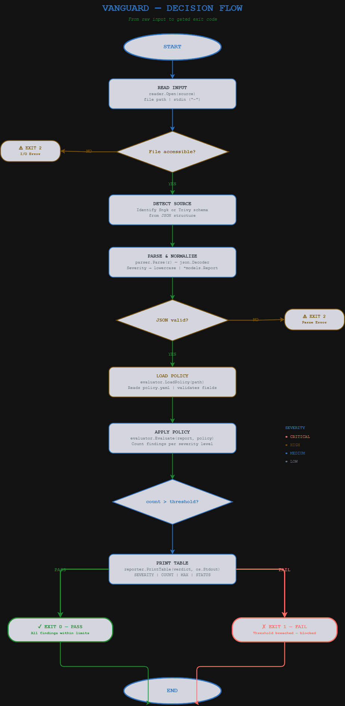

# Vanguard

A high-performance DevSecOps CLI tool written in Go. Vanguard reads security scan reports (Snyk, Trivy), evaluates them against a YAML policy, and gates your CI/CD pipeline with strict exit codes.

## Architecture


## Decision Flow



## How It Works

Vanguard runs a four-stage pipeline:

1. **Reader** — Opens a JSON report file or reads from stdin.
2. **Parser** — Streams and decodes the JSON into a normalized report. Severity values are lowercased automatically.
3. **Evaluator** — Counts findings per severity and compares against thresholds defined in `policy.yaml`.
4. **Reporter** — Prints a severity breakdown table to stdout and returns an exit code.

### Exit Codes

| Code | Meaning |
|------|---------|
| `0`  | **PASS** — All findings are within policy thresholds |
| `1`  | **FAIL** — One or more thresholds breached |
| `2`  | **ERROR** — Bad config, missing file, or invalid JSON |

## Installation

### Prerequisites

- [Go 1.21+](https://go.dev/dl/)

### Build from source

```bash
git clone https://github.com/theprideofwolves/vanguard.git
cd vanguard
go build -o vanguard ./cmd/vanguard
```

The binary will be created in the current directory.

## Usage

### 1. Define a policy

Create a `policy.yaml` file (one is included by default):

```yaml
apiVersion: vanguard/v1
kind: SecurityPolicy
metadata:
  name: default-baseline
thresholds:
  critical: 0
  high: 2
  medium: 10
  low: -1    # unlimited
  info: -1   # unlimited
```

### 2. Run against a report

```bash
# File input
./vanguard -p policy.yaml report.json

# Stdin pipe
cat report.json | ./vanguard -p policy.yaml -
```

### 3. Example output

```
SEVERITY   COUNT   MAX   STATUS
--------   -----   ---   ------
critical   2       0     FAIL
high       1       2     OK
medium     1       10    OK
low        1       ∞     OK
info       0       ∞     OK

Result: FAIL
  ✗ critical: found 2 (max allowed 0)
```

### Jenkins integration

```groovy
stage('Security Gate') {
    steps {
        sh './vanguard -p policy.yaml trivy-report.json'
    }
}
```

Vanguard returns exit code `1` on policy violation, which fails the Jenkins stage automatically.

## Project Structure

```
vanguard/
├── cmd/vanguard/main.go        # CLI entrypoint
├── internal/
│   ├── models/finding.go       # Finding, Report, Severity types
│   ├── reader/reader.go        # File/stdin input
│   ├── parser/parser.go        # Streaming JSON decoder
│   ├── evaluator/
│   │   ├── evaluator.go        # Threshold evaluation logic
│   │   └── policy.go           # YAML policy loader
│   └── reporter/reporter.go    # Table output
├── policy.yaml                 # Default security policy
├── assets/                     # Architecture and flow diagrams
└── spec.md                     # Original specification
```
