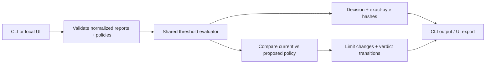

# Vanguard

A Go security policy gate with **policy-change impact analysis**. Evaluate normalized
JSON findings against YAML limits, then see which reports would change verdict
under a proposed policy. **It does not scan vulnerabilities or certify compliance.**

**Recorded verification:** 85.5% whole-project statement coverage and 3,072 seeded
reference-model cases. A 10,000-finding synthetic report took **71.9 ms median**
for in-process parsing/evaluation/hashing (five samples, Windows 11, Ryzen 9 5980HX,
Go 1.25.5). [Full results and raw evidence](docs/verification/2026-11-10-windows/RESULTS.md)
include functional checks, fuzz runs, allocations and measurement limits.

## Try it

Build with **Go 1.25.5+**. The commands below use Windows; on Linux build
`-o vanguard` and run `./vanguard`. Published releases may lag this branch.

```sh
go build -o vanguard.exe ./cmd/vanguard
./vanguard.exe                                     # Local UI
./vanguard.exe -p policy.yaml -json testdata/report-fail.json
./vanguard.exe compare -base testdata/impact/base.yaml -candidate testdata/impact/candidate.yaml testdata/impact/reports
```

**Why compare policies?** The bundled example passes two reports under each policy,
but a critical finding becomes allowed while a high finding becomes disallowed.
Vanguard identifies both transitions and flags the relaxed critical limit for review.
See the [reproducible walkthrough](examples/policy-review.md).

## Architecture



- Equality passes; exceeding a limit fails. Omitted limits and `-1` are unlimited.
- Comparison flags **any relaxed limit**, even when sample verdicts do not change.
  It explains effects on supplied reports; it does not approve a policy.
- Strict schemas reject unknown fields/severities, duplicate findings and ambiguous
  JSON keys. Reports: 16 MiB each; policies: 1 MiB each. CLI comparison: 1–32 reports,
  64 MiB total, one file or a nonrecursive directory. UI comparison: one report.
- JSON exports identify exact input bytes with SHA256. Hashes do not prove authenticity.

| Exit | Evaluation | Policy comparison |
| --- | --- | --- |
| `0` | PASS | No effective limit relaxed |
| `1` | Policy FAIL | Relaxed limit requires review |
| `2` | Input, configuration or tool/output error | Same |

## Workflows and privacy

Evaluation supports explicit stdin (`-`). Optional evaluation-only `-notify` uses
`VANGUARD_SLACK_WEBHOOK`; it sends a failure summary without finding descriptions.
Delivery failure preserves the verdict. Comparison never sends Slack. See
[evaluation CI](examples/github-action.yml) and [policy-review CI](examples/github-policy-review.yml).

The UI works offline on localhost, with white/black themes and a teal accent.
It keeps only the current evaluation or comparison in memory; invalid submissions
clear export. Export before stopping with Ctrl+C. Only guide completion persists;
theme is a browser cookie. Large uploads may use temporary files.
`VANGUARD_DATA_DIR` overrides the guide directory's parent; nonempty
`VANGUARD_NO_BROWSER` disables browser opening.

```sh
go test -race -count=1 ./...
go vet ./...
python .github/scripts/smoke.py ./vanguard.exe
```

To reproduce the full report: `python .github/scripts/verify.py --output tmp/verification-review`.
Tests use synthetic data and mocked Slack. [Testing/manual checklist](TESTING.md) ·
[Architecture](architecture.md) · [Interview guide](interviewprep.md)
