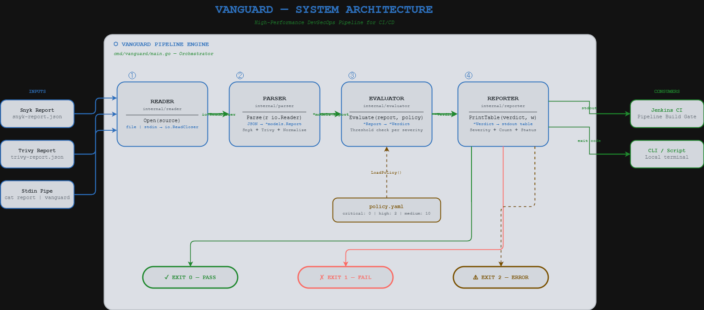

# Vanguard
### Policy evaluation components for security findings
A Go prototype that compares normalized JSON security findings against YAML severity thresholds and produces a consistent pass/fail summary.

## What I built
- File and stdin reader components for normalized reports.
- JSON parsing with lowercase severity normalization.
- YAML policy loading and per-severity finding counts.
- Threshold evaluation with explicit policy violations.
- A table reporter with a fixed severity order and sample pass/fail reports.

## Architecture
`normalized JSON -> parser -> finding counts + YAML policy -> verdict -> table reporter`

The internal packages are connected by `cmd/vanguard`. The CLI returns 0 for PASS, 1 for a policy violation, and 2 for invalid input or configuration.



## Inspect the components
Requires Go 1.25.5 or newer, matching `go.mod`.

```bash
git clone https://github.com/theprideofwolves/vanguard.git
cd vanguard
go mod download
go build ./...
```

Build a runnable CLI with `go build -o vanguard ./cmd/vanguard`, then run `./vanguard -p policy.yaml testdata/report-pass.json` (Windows: build `vanguard.exe` and run `.\vanguard.exe`).

| Package | Role |
| --- | --- |
| `internal/reader` | Open a file or stdin |
| `internal/parser` | Decode the normalized report and lowercase severities |
| `internal/models` | Report, finding, and severity types |
| `internal/evaluator` | Load YAML policy, count findings, return verdict |
| `internal/reporter` | Print severity table and violations |

## Policy example
```yaml
apiVersion: vanguard/v1
kind: SecurityPolicy
metadata:
  name: default-baseline
thresholds:
  critical: 0
  high: 2
  medium: 10
  low: -1
  info: -1
```

A count greater than its threshold fails evaluation. A threshold of `-1`, or an omitted threshold, is unlimited. Review `testdata/report-pass.json` and `testdata/report-fail.json` for sample inputs.

## Current scope
Input must follow the repository's normalized `Report` schema. Direct Snyk/Trivy adapters and automated remediation are not implemented. The parser rejects unknown severities, missing findings arrays, and extra JSON documents. Policy loading rejects unsupported schema versions/kinds, unknown YAML fields, invalid thresholds, empty thresholds, and multiple policy documents. A CI stage can invoke the built binary to use its exit code.

## Resume bullets
- Implemented Go components that parse normalized JSON security findings, normalize severity values, and evaluate finding counts against YAML policy thresholds.
- Built deterministic severity summaries and policy-violation reporting, with sample pass/fail inputs for a security pipeline gate prototype.


## Interview demonstration and verification
See [INTERVIEW.md](INTERVIEW.md) for a walkthrough, expected results, design decisions, and limitations. Run `go test ./...`, `go vet ./...`, and `go build ./...`. GitHub Actions also runs the race detector on Linux.
