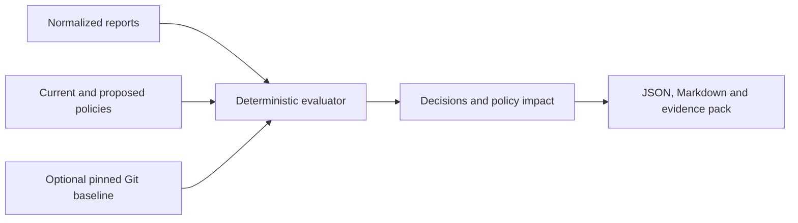

# Vanguard

**Policy-as-code evaluation, policy-change impact analysis and reviewable CI decisions.**
Vanguard evaluates normalized JSON findings against YAML severity limits. It does
not scan vulnerabilities, approve policies or certify compliance.

**New workflow status:** pinned Git review, shadow mode and Markdown/evidence-pack
exports are implemented and compile, but await manual verification. No new test
results are claimed. Earlier [recorded results](docs/VERIFICATION.md) apply to their
identified November 10 source commits, not this extension.

## Start locally

No AI account, API key, hosted service or database is required. Build with
Go 1.25.5+; the pinned-review command also needs Git 2.45+. On Linux use `-o vanguard`
and `./vanguard` instead of the Windows commands below.

```powershell
go build -trimpath -o vanguard.exe ./cmd/vanguard
.\vanguard.exe                                   # Local UI
.\vanguard.exe -p policy.yaml -json testdata/report-fail.json
$baseline = (git rev-parse HEAD).Trim()
.\vanguard.exe review -base-ref $baseline -base-policy testdata/impact/base.yaml -candidate testdata/impact/candidate.yaml testdata/impact/reports
```

The review example compares the same four reports under two policies. Both pass
two reports, but a critical finding becomes permitted while a high finding becomes
rejected. Expected review exit: `1`. See the [manual walkthrough](docs/MANUAL-REVIEW.md).
Published portable binaries may lag this source version.

## How it works



- Equality passes; exceeding a finite limit fails. Omitted limits and `-1` are unlimited.
- Comparison flags any relaxed limit, including changes that no sample exercises.
- `review` reads the baseline from an exact local commit; it does not fetch, check
  out or execute candidate code. The operator must choose that commit from a trusted context.
- Shadow mode records the proposal while retaining the pinned baseline's gate status.
- A new optional pack contains the readable review, paired decisions, policy
  snapshots and a hash manifest. It does not copy report contents or overwrite an existing pack.
- Inputs are bounded: 1 MiB/policy, 16 MiB/report, 32 reports and 64 MiB/corpus.
  Unknown fields/severities, duplicate findings and ambiguous JSON keys are rejected.

| Mode | Exit 0 | Exit 1 | Exit 2 |
| --- | --- | --- | --- |
| Evaluation | PASS | Policy FAIL | Input/tool/output error |
| Compare / review | No relaxed limits | Relaxation needs review | Error |
| Shadow | All reports pass pinned baseline | Baseline FAIL | Error |

Hashes identify exact bytes, not report authenticity or human approval. The same
inputs produce the same decision facts; timestamps and build metadata can differ.
The sample corpus does not predict outcomes for unseen reports.

## Use and verification

The UI runs on localhost with white/black themes. Inputs/evidence stay in its
session; invalid submissions clear exports. Export before closing with Ctrl+C.
`VANGUARD_DATA_DIR` overrides the guide directory's parent; nonempty
`VANGUARD_NO_BROWSER` disables browser opening. Explicit stdin (`-`) works for
ordinary evaluation. Optional `-notify` sends a failure summary through the user's
Slack webhook; compare/review/shadow never notify. Jira and AI APIs are not implemented.

[Policy review and trust boundary](docs/POLICY-REVIEW.md) ·
[Manual acceptance and screenshots](docs/MANUAL-REVIEW.md) ·
[Architecture](architecture.md) · [Interview guide](interviewprep.md) ·
[Running costs and optional AI](docs/USAGE-AND-COST.md)

An unexecuted [trusted-baseline CI template](examples/github-trusted-policy-review.yml)
keeps the tool/corpus on base code and reads the candidate policy as data. It needs
manual verification and protected workflow settings before use. Existing automated
verification commands remain in [TESTING.md](TESTING.md); execution of tests and CI
for this extension is deferred to the owner. No new benchmark or coverage claim is made.
