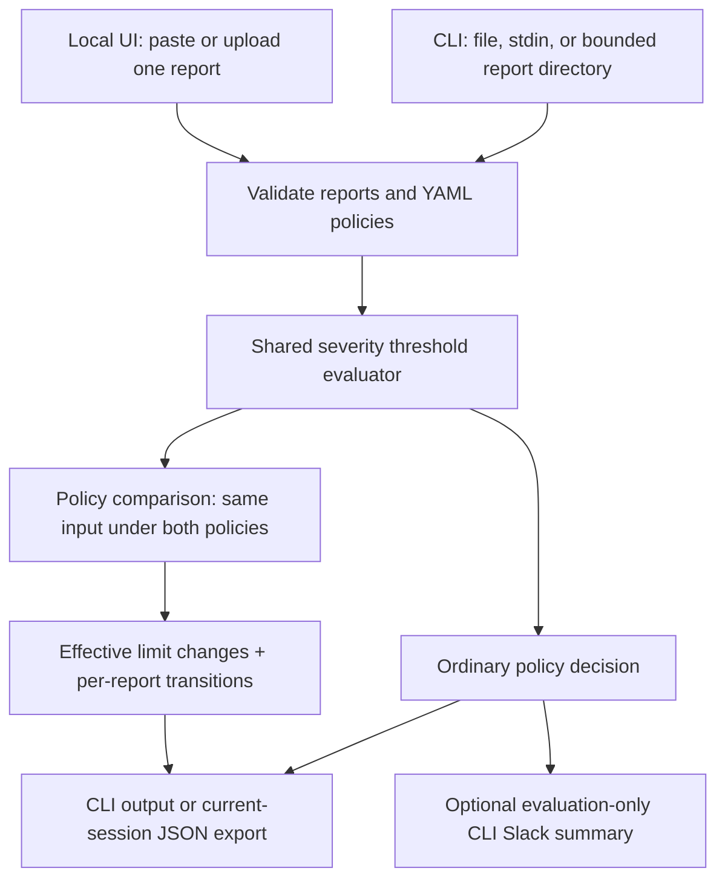

# Vanguard architecture

Vanguard makes two decisions explicit: whether findings meet a policy, and how a
proposed policy changes the limits and observed verdicts. It consumes normalized
reports; assessment/scanning and report normalization happen upstream.

## Evaluation

`cmd/vanguard/main.go` selects CLI evaluation or launches the local UI. It reads
bounded report/policy bytes, calls `gate.Evaluate`, writes text or JSON and returns
0/1/2 for PASS/policy FAIL/error. Explicit `-` reads stdin. `-notify` runs only after
a valid failed decision is written; notification failure never changes the verdict.

`internal/parser` checks UTF-8, one JSON document, duplicate keys (including case
folds), unknown fields, findings shape, severity and duplicate normalized finding
objects. It normalizes severity case. Distinct modeled objects count separately.

`internal/evaluator` accepts one bounded YAML policy with the required version/kind,
known fields and integer severity limits >= -1. At least one threshold is required.
It fails a report only when a count is strictly greater than a finite limit.
Omitted thresholds and -1 are unlimited. Counts are ordered critical/high/medium/low/info.

`internal/gate/gate.go` constructs an ordinary `vanguard-decision/v1` decision with
counts, limits, violations, UTC time and exact-byte hashes. `decisionFor` is shared
by ordinary evaluation and comparison; the comparison does not implement a second
threshold engine.

## Policy comparison

`vanguard compare -base current.yaml -candidate proposed.yaml [-json] reports-dir`
is dispatched to `cmd/vanguard/compare.go`. A single report file also works.
Only top-level `.json` files are selected, case-insensitively. Empty corpora,
nonregular files/symlink entries, too many files and oversized reads fail.
Directory enumeration stops at 4097 entries and rejects more than 4096 entries.
No recursive filesystem search, scanner invocation or network access occurs.

`gate.ComparePolicies` validates both policies once, bounds the corpus, copies and
sorts report labels, then parses each report once. For each report, it evaluates
the identical normalized findings under both policies through `decisionFor`.
Full base/candidate decisions retain the same input hash and timestamp. Any invalid
member returns an error and no impact result; the CLI emits no evidence on validation
failure. An output failure returns 2 and may leave a partial output file, which must
not be treated as valid evidence.

A limit is canonicalized to `(Limited=false, Allowed=-1)` when omitted or -1.
Finite to larger finite, or finite to unlimited, is relaxed. Unlimited to finite,
or finite to smaller finite, is tightened. Effective equality is unchanged;
policy names/comments/formatting can change hashes without changing semantics.

The `vanguard-impact/v1` result includes both policy hashes/names, ordered limit
changes, a summary and report pairs. A report transitions pass_to_pass,
fail_to_pass, pass_to_fail or fail_to_fail. A fail_to_pass result necessarily means
its prior violations became permitted through relaxation: the report bytes did
not change. Both policies may pass the same number of reports while admitting
different reports. Report counts describe samples, not unique vulnerabilities.

`ReviewRequired` is true if ANY effective limit is relaxed, independently of sample
outcomes. Comparison exits 0=no relaxation, 1=review required, 2=error. Exit 0 does
not mean candidate reports all pass or authorize a policy change. Mixed tightening
and relaxation still needs review. Comparison rejects `-notify` and has no Slack path.

## UI and state

`cmd/vanguard/ui.go` serializes evaluations, comparisons and exports using a mutex.
Both operations use the same pasted/uploaded report; upload wins. An optional
candidate-policy field enables single-report comparison. Either operation replaces
the single current evidence slot. Invalid submissions clear it before upload parsing.
`/export` returns only the current valid decision or impact JSON, with the appropriate
filename. Guide navigation and appearance changes preserve inputs/evidence.

`internal/onboarding` owns welcome, sample downloads and the completion preference.
A valid FAIL or comparison needing review completes the guide. Malformed data does not.
Restarting the process loses report/policy inputs and both kinds of evidence.
`internal/desktop/theme.go` provides shared white/black CSS with a teal accent and a
protected theme form POST. Its allowlisted browser cookie is independent of evidence.
No JavaScript, external assets, database or saved report history is used.

## Boundaries and complexity

Reports are capped at 16 MiB, each policy at 1 MiB, a comparison corpus at 32 reports
and 64 MiB total. UI HTTP requests also have a 128 MiB outer cap; multipart parsing
may stage large uploads to temporary files, removed after processing. Bounds are
not claims about measured peak RSS or sustained workload performance.

For B input bytes, F findings and R reports, comparison work is approximately
O(B + F + R log R); the severity set is fixed at five. CLI retains bounded raw corpus
bytes while reports are parsed sequentially. Decisions store counts rather than
finding descriptions. Parser validation also uses temporary maps and decoded objects.

The server binds only to loopback, with per-launch token, exact Host/Origin checks,
CSP, escaping and request limits. This is a single-user OS boundary: privileged local
processes can read memory. Inputs may be incomplete or forged. Hashes identify bytes,
not authenticity, scanner success, exploitability or compliance. Sample outcomes do
not predict unseen reports; explicit approval and upstream assessment checks remain
outside Vanguard. See TESTING.md for verified behavior and remaining manual checks.
