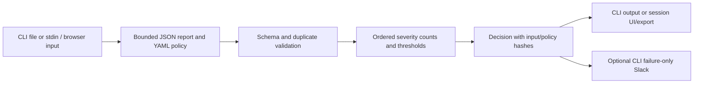

# Vanguard: implemented architecture

## Source map

- cmd/vanguard/main.go reads capped inputs and selects text/JSON output and exit
  0/1/2. reader.Open handles an explicit file or stdin via '-'. No args launches UI.
- internal/parser/parser.go retains at most the configured 16 MiB report input,
  rejects unknown/ambiguous fields and duplicate normalized findings, then
  lowercases severity. It does not parse native scanner schemas.
- internal/evaluator/policy.go validates a single bounded YAML policy and its
  version, kind and thresholds. evaluator.go counts findings in fixed severity
  order; a count strictly greater than a configured nonnegative limit fails.
- internal/gate/gate.go combines validation/evaluation with exact-byte input
  hashes, timestamp and ordered decision rows. Optional Slack is CLI-only,
  request-bounded, and cannot change the already computed verdict.
- cmd/vanguard/ui.go serializes actions, accepts pasted or uploaded report data,
  evaluates through the same gate, and exports only the current valid decision.
  Invalid evaluation clears the previous decision. No report history is saved.
  Multipart uploads above the in-memory budget can use OS temporary files;
  request cleanup removes them after processing.
- internal/desktop launches loopback HTTP with a random token/port and strict
  request guards. internal/onboarding owns welcome/setup and fixed sample downloads.

## Onboarding and state

The demo is intentionally a FAIL decision. Successful evaluation, not PASS,
completes onboarding. Setup/sample reads and malformed input do not complete it.
Only a small completion preference persists. A running session keeps its decision
when the guide is reopened; restarting the executable loses decision/input state.
No connection check, folder scanner, account setup or ticket adapter is present.

## Trust and resource boundaries

This is a single-user local tool, not a shared deployment. Host/token/origin
checks, escaping, CSP and request limits protect ordinary local browser access;
a privileged OS process can read memory. Parsing is bounded in memory rather
than unlimited streaming. No scanner invocation or benchmark/compliance verdict
is established. An empty findings array can pass without proving a scanner ran.
Hashes identify exact bytes, not authenticity or completeness. Only optional
CLI Slack transmits a summary. Local evaluation requires no network access.

Tests cover threshold/exit-code boundaries, malformed input, duplicate findings,
bounded intake, notification failures, local requests, uploads and export.
CI exercises Windows/Linux and the actual packaged binary. Live Slack delivery,
interactive clean-OS launch, accessibility and resource measurements remain
separate validation; tests do not establish enterprise production readiness.
